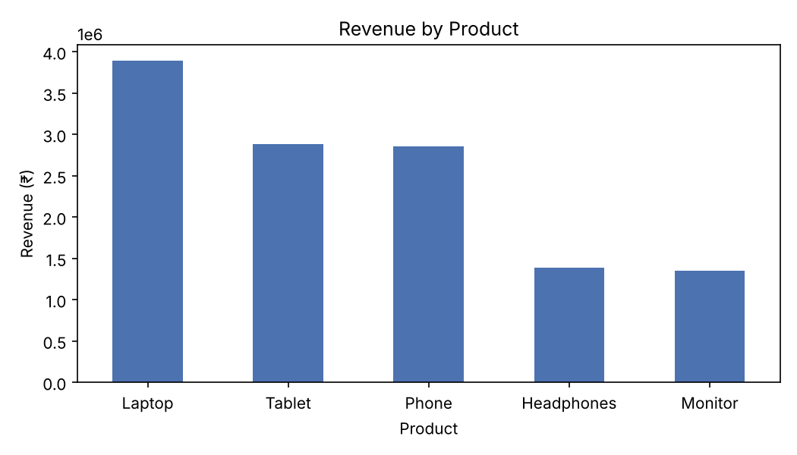

# Sales Analysis Report

## Project Overview
Analysis of 100 sales records (01 Jan 2024 to 09 Apr 2024)
to find total sales, the best-selling product and other key metrics.

## Data Quality
- Rows: 100, Columns: 7
- Missing values: 0
- Duplicate rows: 0
- Total_Sales vs Quantity x Price mismatches: 0
- Cleaning applied: dates converted to datetime; duplicates dropped; missing numbers filled with median.
  (This dataset was already clean, so nothing needed changing.)

## Key Metrics
| Metric | Value |
|---|---|
| Total revenue | ₹12,365,048 |
| Average sale | ₹123,650 |
| Highest sale | ₹373,932 (Phone, South) |
| Lowest sale | ₹6,540 (Tablet, North) |
| Best product by revenue | Laptop |
| Best product by units | Laptop |

## Revenue by Product
| Product | Revenue | Units |
|---|---|---|
| Laptop | 3,889,210 | 136 |
| Tablet | 2,884,340 | 127 |
| Phone | 2,859,394 | 101 |
| Headphones | 1,384,033 | 48 |
| Monitor | 1,348,071 | 66 |

## Revenue by Region
| Region | Revenue |
|---|---|
| North | 3,983,635 |
| South | 3,737,852 |
| East | 2,519,639 |
| West | 2,123,922 |

## Monthly Revenue
| Date | Revenue |
|---|---|
| 2024-01 | 4,120,524 |
| 2024-02 | 2,656,050 |
| 2024-03 | 4,485,006 |
| 2024-04 | 1,103,468 |

## Insights
- **Laptop** earns the most revenue (₹3,889,210, 31% of total) and also sells the most units.
- **North** and **South** together bring in 62% of revenue; **West** is the weakest region.
- April has only 9 days of data, so its low total is not a real drop.
- Tablet has the most orders (26) but Laptop earns more because of higher prices.
